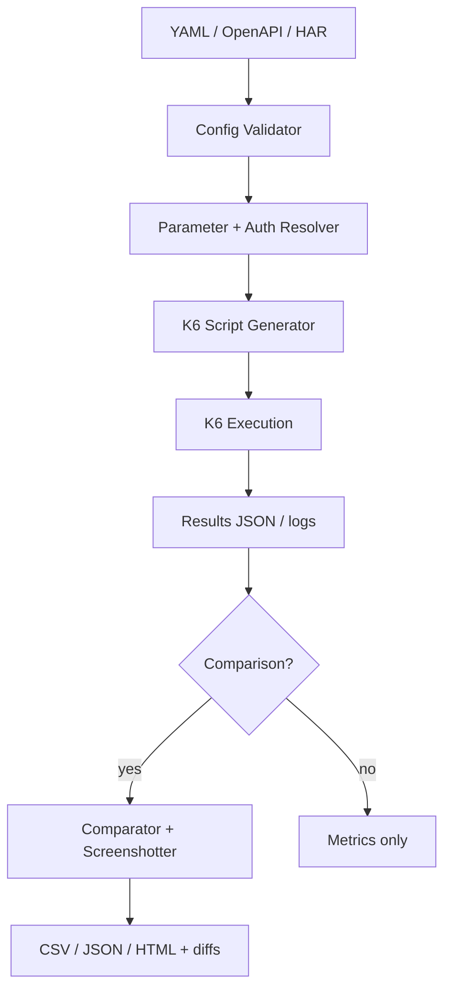

# Architecture

## Overview

Synapse turns YAML into K6 load tests and optional version/environment comparisons (image, text, screenshot, visual-text). An MCP server wraps the CLI for LLM-driven runs.

## Core Components

### Configuration Validator
- Joi schema for execution, parameters, auth, request checks, comparison, screenshots
- File existence checks for CSV/batch sources

### Importers
- **OpenAPI**: path/method → construct-mode config + auth stubs
- **HAR**: GET/HEAD URLs → batch-mode config + CSV

### Parameter Generators
Integer, string, array, CSV, URL, static — with optional `in: path|query`

### K6 Script Generator
- Construct / batch modes
- Auth headers or query keys
- JSON bodies and response checks
- Comparison logging for post-processing

### Comparison Pipeline
- **Comparator**: image (Sharp + pixelmatch), text/JSON (normalize + ignore paths), screenshot / visual-text (Puppeteer)
- **Screenshotter**: viewports, masks, selectors, fullPage, waitForSelector
- **HTML report**: self-contained summary with screenshot/diff previews
- **Post-processor**: enriches K6 comparison logs; supports `failOnDiff` for CI

### CLI / MCP / CI
- CLI: `init`, `run`, `test`, `validate`, `generate`, `compare`, `import`, `doctor`
- MCP tools mirror CLI capabilities
- GitHub Action + Docker image for pipelines

## Execution Modes

### Construct Mode
Build URLs from `baseUrl` + parameters (path placeholders and/or query).

### Batch Mode
Replay pre-built URLs from CSV (including HAR imports).

## Data Flow

1. Input: YAML, or import from OpenAPI/HAR
2. Validate schema and local files
3. Generate parameter values / script
4. Run K6 (exit non-zero on threshold fail)
5. Optional comparison → CSV/JSON/HTML + diff PNGs
6. Optional `--fail-on-diff` → exit code `3`
